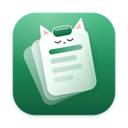
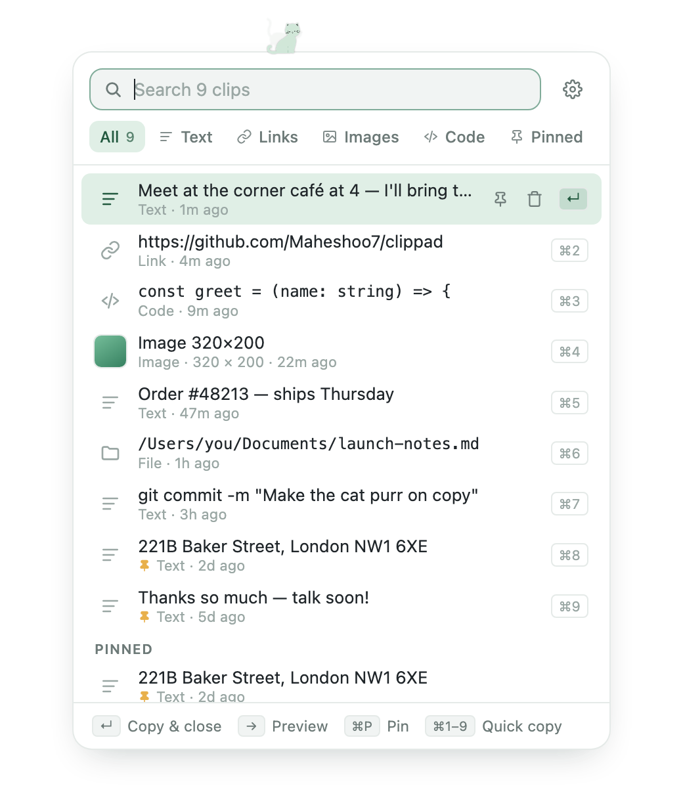

<div align="center">



# ClipPad

**Everything you copy, one shortcut away.**

A fast, private, open-source clipboard history manager for macOS — with a little cat who keeps it all safe.

[](https://github.com/Maheshoo7/clippad/actions/workflows/ci.yml)
[](https://github.com/Maheshoo7/clippad/releases)
[](LICENSE)

[](https://tauri.app)

[Download](#-install) · [How to use](#-how-to-use) · [Privacy](#-privacy--security) · [Contributing](CONTRIBUTING.md) · [Meet the cat](#-the-cat-who-kept-everything)

<br />

<picture>
  <source media="(prefers-color-scheme: dark)" srcset="docs/images/screenshot-dark.png" />
  
</picture>

</div>

---

## ✨ Why ClipPad?

Your clipboard holds one thing at a time. Copy something new and the last thing is gone — the link you meant to send, the address you just typed, the snippet you'll need again in five minutes.

ClipPad quietly remembers **everything you copy** and brings it back the moment you press <kbd>⌘</kbd><kbd>⇧</kbd><kbd>V</kbd>. Type a few letters, hit <kbd>Enter</kbd>, paste. The whole thing takes about two seconds, and then ClipPad gets out of your way.

- 🪶 **Invisible until summoned** — lives in the menu bar. No Dock icon, no windows to manage.
- 🔒 **Private by design** — your history never leaves your Mac. No accounts, no cloud, no telemetry, no network access at all.
- ⌨️ **Keyboard-first** — every action has a shortcut; everything is also clickable.
- ⚡ **Native and light** — built with [Tauri](https://tauri.app) and Rust: a small download that sips memory while it runs all day.
- 🐈 **Has a cat** — who naps in your menu bar and wakes up whenever you copy something.

## 🧰 Features

| | |
|---|---|
| **Captures everything** | Text, links, code, images and files copied from Finder — saved the instant you copy, even while the panel is closed. |
| **Smart types** | Links and code are recognised automatically, so you can filter by **Text · Links · Images · Code · Pinned**. |
| **Instant search** | Just start typing — no need to click the search box. |
| **No duplicates** | Copy the same thing twice and it simply moves back to the top. |
| **Pins** | Pin the things you paste all the time (addresses, sign-offs, commands). Pinned clips never expire. |
| **Preview pane** | Press <kbd>→</kbd> to see the full text or a larger image without leaving the keyboard. |
| **Quick copy** | <kbd>⌘1</kbd>–<kbd>⌘9</kbd> grab one of your nine most recent clips in one keystroke. |
| **Crash-proof history** | Every copy is written straight to a local SQLite database, so quitting, crashing or restarting never loses a clip. |
| **Works everywhere you are** | The panel opens on whichever screen you're using — great with external monitors. |
| **Light & dark** | Follows your system appearance, or pick one in Settings. |
| **Launch at login** | Shows up in **System Settings → General → Login Items** like any well-behaved Mac app. |

## 📦 Install

### Download (recommended)

1. Go to the [**latest release**](https://github.com/Maheshoo7/clippad/releases/latest).
2. Download the DMG for your Mac:
   - **Apple Silicon** (M1 and later): `ClipPad_x.y.z_aarch64.dmg`
   - **Intel**: `ClipPad_x.y.z_x64.dmg`
3. Open the DMG and drag **ClipPad** into **Applications**.
4. Open ClipPad from Applications. A sleeping cat appears in your menu bar — that's it.

> [!NOTE]
> ClipPad isn't notarised by Apple yet, so the first time you open it macOS will say it can't verify the developer. To open it anyway:
>
> - **macOS 15 Sequoia and later:** try to open ClipPad once, then go to **System Settings → Privacy & Security**, scroll down and click **Open Anyway**.
> - **macOS 14 and earlier:** right-click ClipPad in Applications, choose **Open**, then click **Open** again.
>
> Or, in Terminal: `xattr -dr com.apple.quarantine /Applications/ClipPad.app`
>
> You only need to do this once.

### Build from source

You'll need [Node.js](https://nodejs.org) 20+, [Rust](https://rustup.rs) and the Xcode Command Line Tools (`xcode-select --install`).

```sh
git clone https://github.com/Maheshoo7/clippad.git
cd clippad
npm install
npm run tauri build
```

The app lands in `src-tauri/target/release/bundle/macos/ClipPad.app` and the installer in `src-tauri/target/release/bundle/dmg/`. See [docs/BUILDING.md](docs/BUILDING.md) for universal binaries, signing and troubleshooting.

### Requirements

macOS 10.15 Catalina or later, on Apple Silicon or Intel. Launch-at-login uses the modern Login Items API on macOS 13 and later.

## 🚀 How to use

1. **Copy things as usual.** ClipPad saves each one in the background.
2. **Press <kbd>⌘</kbd><kbd>⇧</kbd><kbd>V</kbd>** (or click the cat in the menu bar) to open your history.
3. **Find what you want** — start typing to search, or use the arrow keys.
4. **Press <kbd>Enter</kbd>.** ClipPad copies it and closes. Now paste with <kbd>⌘V</kbd> wherever you like.

> [!TIP]
> ClipPad copies the clip back to your clipboard rather than typing it into the other app, so it needs **no Accessibility permission** and works the same in every app.

### Keyboard shortcuts

| Shortcut | What it does |
|---|---|
| <kbd>⌘</kbd><kbd>⇧</kbd><kbd>V</kbd> | Open or close ClipPad from anywhere |
| *Just type* | Search your history |
| <kbd>↑</kbd> <kbd>↓</kbd> | Move through clips |
| <kbd>Enter</kbd> | Copy the selected clip and close |
| <kbd>⌘1</kbd> – <kbd>⌘9</kbd> | Copy one of the nine most recent clips |
| <kbd>→</kbd> / <kbd>←</kbd> | Open / close the preview pane |
| <kbd>⌘P</kbd> | Pin or unpin the selected clip |
| <kbd>⌘</kbd><kbd>⌫</kbd> | Delete the selected clip |
| <kbd>Esc</kbd> | Close ClipPad |

You can also click any clip to copy it, and hover a row for the pin and delete buttons.

### Settings

Click the ⚙︎ gear in the panel:

- **Appearance** — System, Light or Dark.
- **History limit** — keep the last 100, 500 (default), 1,000 or unlimited clips. Pinned clips are always kept; the 30 most recent images are stored.
- **Capture images** — turn off if you only care about text.
- **Launch at login** — on by default.
- **Clear history** — removes everything except your pins.
- **Quit ClipPad** — since there's no Dock icon, this is how you quit (or right-click the menu-bar cat).

### Playing with the cat

- In the **menu bar**, the cat dozes until you copy something — then it jolts awake. It opens its eyes when the panel is up, follows your <kbd>↑</kbd>/<kbd>↓</kbd>, purrs when you copy a clip back, winks when you pin and winces when you delete.
- On the **panel**, it wanders along the top edge. **Click** it to make it walk, sleep, or wake up. **Move your mouse over it** while it's sitting to stroke it. 💚

The cat respects **Reduce Motion** in your accessibility settings.

## 🔐 Privacy & security

- **100% local.** History is stored on your Mac in `~/Library/Application Support/io.github.maheshoo7.clippad/history.sqlite`. ClipPad makes no network requests and contains no analytics.
- **It keeps what you copy — including passwords.** If you copy a password from a password manager, ClipPad saves it like anything else. Delete any clip with <kbd>⌘</kbd><kbd>⌫</kbd>, or clear your history in Settings.
- **The history file isn't encrypted.** It's protected by your macOS user account (and by FileVault, if you use it), like the rest of your files.
- **Locked-down app.** The interface runs under a strict Content Security Policy and can only call the handful of native commands ClipPad needs.

Found a security issue? Please report it privately — see [SECURITY.md](SECURITY.md).

## ❓ FAQ

<details>
<summary><b>The shortcut doesn't work.</b></summary>

Another app may already use <kbd>⌘</kbd><kbd>⇧</kbd><kbd>V</kbd>. ClipPad shows a warning in Settings when that happens; you can still open it from the menu-bar cat.
</details>

<details>
<summary><b>How do I stop ClipPad from starting at login?</b></summary>

Turn off **Launch at login** in ClipPad's Settings, or remove it in **System Settings → General → Login Items**.
</details>

<details>
<summary><b>How do I uninstall ClipPad completely?</b></summary>

Quit ClipPad, drag it from Applications to the Bin, then delete `~/Library/Application Support/io.github.maheshoo7.clippad` to remove your history.
</details>

<details>
<summary><b>Does it work on Windows or Linux?</b></summary>

Not yet. ClipPad is built with Tauri, which runs on Windows and Linux, and parts of the code already have fallbacks for them, but only macOS is tested and released today. Help is very welcome — see [CONTRIBUTING.md](CONTRIBUTING.md).
</details>

## 🗺️ Roadmap

- [ ] Paste straight into the previous app (optional, with Accessibility permission)
- [ ] Paste as plain text
- [ ] Ignore list for apps you never want recorded
- [ ] Customisable global shortcut
- [ ] Signed and notarised builds, plus a Homebrew cask
- [ ] Windows and Linux support

Have an idea? [Open a feature request](https://github.com/Maheshoo7/clippad/issues/new/choose).

## 🤝 Contributing

Contributions of all sizes are welcome — bug reports, ideas, docs, design and code. Start with [CONTRIBUTING.md](CONTRIBUTING.md); it walks you through setup in a few minutes. Please follow our [Code of Conduct](CODE_OF_CONDUCT.md).

## 🐈 The cat who kept everything


Every evening, Pad curled up in the top-right corner of the screen, right where the menu bar meets the clock. It was warm there, and quiet, and from there she could see everything.

Pad was a keeper. Not of mice — she'd never cared much for mice — but of the small things people let go of without noticing. A phone number, copied and then forgotten. A link someone meant to send to their sister. Half a paragraph, cut from an essay at two in the morning and never pasted anywhere.

Every time something was copied, Pad's ears twitched. She'd jolt awake, pad softly across the panel, and tuck the new thing away with the others — newest on top, the way she liked it. If the same thing came twice, she didn't keep two. She just moved the first one to the front, so it was easy to find.

Her person never noticed. They copied and pasted and copied again, and the day went on.

Then, one afternoon, they lost something. An address they'd copied that morning, gone under a dozen newer things. They sighed. They pressed three keys without much hope.

And there was Pad, sitting on the edge of the panel, tail curled round her paws. The address was right there, just where she'd put it.

They pressed Enter. Pad purred.

After that, her person started pinning the important things — the address, a kind sign-off, the command they could never remember — and Pad would wink each time, as if to say *good idea*. When they deleted something, she winced a little. She was a keeper, after all. But she understood.

At night, when the panel closed, Pad yawned, turned around three times, and went back to sleep in the corner of the screen.

She never went far. She never told anyone what she'd kept. And she never, ever forgot.

## 🙏 Acknowledgements

- Built with [Tauri](https://tauri.app), [React](https://react.dev), [clipboard-rs](https://github.com/ChurchTao/clipboard-rs) and [rusqlite](https://github.com/rusqlite/rusqlite).
- The cat's walk cycle is a free animation from [LottieFiles](https://lottiefiles.com), used under the [Lottie Simple License](https://lottiefiles.com/page/license).

## 📄 License

ClipPad is free and open-source software under the [MIT License](LICENSE).
